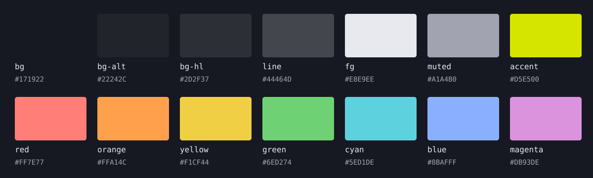

# The Deliverator

A design language for the things I make: dark surfaces, charged color, readable type, and controls that respond quietly.

[See it in the workshop](https://mattkelly.io/) · [Use the library](docs/components.md) · [Style guide](docs/design-system.md) · [Agent workflow](docs/agent-entry.md)



Iosevka Etoile for headings. Aile for reading and controls. Iosevka Mono for code and breadcrumbs. Phosphor icons throughout, with restrained motion and a reduced-motion path.

The web identity is accepted; the component library is growing as real projects adopt it. The npm package is unpublished, and editor/terminal ports remain previews. [What is verified](docs/verification.md).

## Use it

```sh
npm ci
npm run check
npm run build
npm run storybook
```

[Integrate a revision-pinned web export](docs/adoption.md). Compose the shared controls and exhibit rows; keep application state and engines in the application. [Component contracts](docs/components.md) · [Typography](docs/typography.md) · [Icons](docs/icons.md) · [Motion](docs/motion.md).

## Colors

Every swatch and value below comes from the same palette generator as the application ports. RGB uses 0-255 channels; OKLCH uses lightness percent, chroma, and hue degrees. Contrast is measured against the ground, not a blanket text-accessibility rating.

<!-- colors:start -->
| Role | Hex | RGB · 0–255 | OKLCH · L C h | Contrast / ground |
| --- | --- | --- | --- | --- |
|  `bg` | `#171922` | `23, 25, 34` | `21.55% 0.0180 275.01` | 1.00:1 |
|  `bg-alt` | `#22242C` | `34, 36, 44` | `26.17% 0.0152 274.24` | 1.13:1 |
|  `bg-hl` | `#2D2F37` | `45, 47, 55` | `30.65% 0.0146 274.40` | 1.31:1 |
|  `line` | `#44464D` | `68, 70, 77` | `39.49% 0.0120 273.11` | 1.86:1 |
|  `fg` | `#E8E9EE` | `232, 233, 238` | `93.47% 0.0068 277.16` | 14.45:1 |
|  `muted` | `#A1A4B0` | `161, 164, 176` | `72.01% 0.0176 274.72` | 7.05:1 |
|  `accent` | `#D5E500` | `213, 229, 0` | `87.97% 0.1990 114.78` | 12.55:1 |
|  `red` | `#FF7E77` | `255, 126, 119` | `73.97% 0.1585 24.83` | 7.09:1 |
|  `orange` | `#FFA14C` | `255, 161, 76` | `78.93% 0.1488 59.83` | 8.72:1 |
|  `yellow` | `#F1CF44` | `241, 207, 68` | `85.99% 0.1549 94.90` | 11.47:1 |
|  `green` | `#6ED274` | `110, 210, 116` | `78.06% 0.1608 145.05` | 9.29:1 |
|  `cyan` | `#5ED1DE` | `94, 209, 222` | `79.95% 0.1049 205.39` | 9.72:1 |
|  `blue` | `#8BAFFF` | `139, 175, 255` | `75.96% 0.1223 265.13` | 8.07:1 |
|  `magenta` | `#DB93DE` | `219, 147, 222` | `75.97% 0.1303 325.39` | 7.71:1 |
<!-- colors:end -->

[Full copyable CSS reference, including HSL](docs/colors.md) · [CSS variables](palette/signal.css) · [JSON](palette/signal.json) · [The color recipe](docs/palette.md).

## Bring it to your tools

| Tool | Import / setup |
| --- | --- |
| VS Code | [Theme extension](ports/vscode/README.md) |
| Neovim | [Colorscheme](ports/neovim/README.md) |
| Unity / Hyper+T | [Desktop palette](ports/unity/README.md) |
| Windows Terminal | [Scheme](ports/windows-terminal/README.md) |
| Alacritty · Kitty · WezTerm | [Alacritty](ports/alacritty/README.md) · [Kitty](ports/kitty/README.md) · [WezTerm](ports/wezterm/README.md) |
| TextMate · bat | [TextMate](ports/textmate/README.md) · [bat](ports/bat/README.md) |

Ports are importable previews; installation and application loading are tracked separately. [Make a port](docs/porting.md).

## Work on the system

Change the recipe or component source, then regenerate and validate. The README lookup table, swatches, palette and ports are generated together.

```sh
python tools/build.py
python tools/build.py --check
python -m unittest discover -s tests -v
```

[Usage grammar](docs/semantics.md) · [Writing](docs/voice.md) · [Next components](docs/design-system.md#next-components-in-order).

MIT for the library; bundled Iosevka fonts retain their OFL license and Phosphor its MIT notice. [License](LICENSE) · [Font provenance](assets/fonts/iosevka-source.json).

Built by [Matt Kelly](https://mattkelly.io/).
