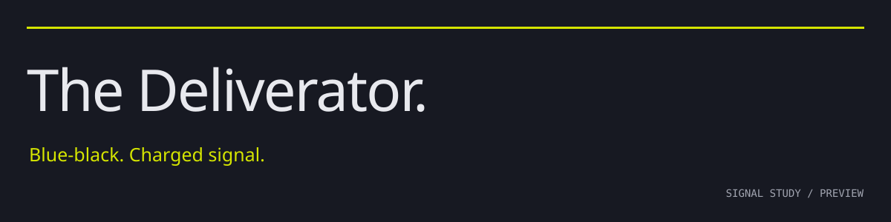

<p align="center"></p>

<p align="center"><a href="#try-it">Try it</a> · <a href="#ports">Ports</a> · <a href="docs/palette.md">The recipe</a> · <a href="docs/porting.md">Make a port</a></p>

A dark color system built around a blue-black ground and one charged yellow-green signal. Inspired by the night courier, engineered materials and electrical urgency of Neal Stephenson’s *Snow Crash*.

**Signal study is a preview.** The ground and accent direction are chosen; the complete palette is still being refined. Generated ports are available to try, but this is not a stable release or a published editor-marketplace extension.


## Try it

The component library is taking shape alongside the palette. Start with the **[design-system guide](docs/design-system.md)**, then the [component contracts and catalogue](docs/components.md). The [agent entry point](docs/agent-entry.md) keeps implementation guidance in one place. This is an unpublished reference slice, not a stable UI kit.

**[Open the live Lisp theme study](https://lisp.mattkelly.io/?theme=deliverator-signal).** Use its palette menu to compare the original Deliverator and other themes. The candidate does not overwrite a saved theme choice.

Or choose an application below. Nothing in this repository changes your configuration automatically.

## Ports

| Application | Import | Instructions |
| --- | --- | --- |
| Neovim | [Lua colorscheme](ports/neovim/colors/deliverator-signal.lua) | [Setup](ports/neovim/README.md) |
| VS Code | [Theme extension](ports/vscode/) | [Preview locally](ports/vscode/README.md) |
| TextMate | [`.tmTheme`](ports/textmate/Deliverator-Signal.tmTheme) | [Import](ports/textmate/README.md) |
| bat | [`.tmTheme`](ports/bat/Deliverator-Signal.tmTheme) | [Cache and select](ports/bat/README.md) |
| Windows Terminal | [Scheme JSON](ports/windows-terminal/deliverator-signal.json) | [Add a scheme](ports/windows-terminal/README.md) |
| Alacritty | [Color TOML](ports/alacritty/deliverator-signal.toml) | [Import](ports/alacritty/README.md) |
| Kitty | [Theme configuration](ports/kitty/deliverator-signal.conf) | [Include](ports/kitty/README.md) |
| WezTerm | [Color scheme TOML](ports/wezterm/deliverator-signal.toml) | [Load](ports/wezterm/README.md) |

All are preview ports. [Validation status](docs/verification.md) distinguishes format checks, application smoke tests and visual acceptance.

For your own tools: **[JSON](palette/signal.json)** · **[CSS](palette/signal.css)** · **[13-role TOML](palette/signal.toml)** · **[ANSI 16](palette/ansi.json)**.

## One palette, an explicit recipe

The only retained RGB input is `#171922`. Its OKLCH hue determines a complementary signal rotated 20° toward green. Surface levels follow fixed lightness steps; supporting inks follow named hue offsets and chroma budgets. Every export comes from that recipe.

The result is reproducible, not mathematically ordained. We choose the character; the generator keeps the relationships consistent, reduces chroma to fit sRGB, and checks contrast after rounding. [Read the derivation](docs/palette.md).

```sh
python tools/build.py
python tools/build.py --check
python -m unittest discover -s tests -v
```

Python 3.11 or newer; no third-party Python packages. Generated files and their hashes are committed. CI checks drift and runs isolated Neovim and bat smoke tests.

## Contributing

Discuss a palette change before changing exports. For a new application, map semantic roles, add a generator and import instructions, and document how it was tested. [Porting guide](docs/porting.md) · [Design research](docs/research.md) · [Next work](docs/roadmap.md).

MIT licensed. *Snow Crash* is an inspiration, not an affiliation or endorsement. No artwork, logos or palette files from the reference theme projects are redistributed here.
